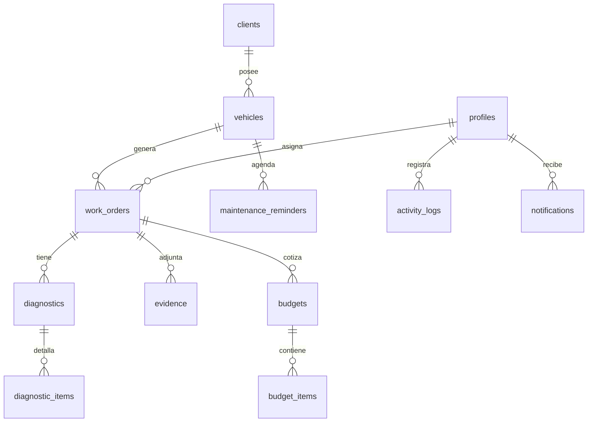

# Arquitectura TallerIQ — Fase 1

## Visión

TallerIQ digitaliza el flujo:

Cliente → Vehículo → Orden → Diagnóstico → Evidencias → Presupuesto → Aprobación → Reparación → Entrega → Historial.

## Capas

```
UI (app/ + components)
  → features/* (hooks + lógica de pantalla)
    → services (acceso a datos)
      → lib/supabase (cliente)
        → Supabase (Auth / Postgres / Storage / Edge Functions)
```

Reglas:

- Las pantallas no llaman a Supabase directamente.
- Validación con Zod + React Hook Form.
- Errores técnicos se traducen en `utils/errors.ts`.
- Autorización real en RLS; el frontend solo mejora UX.

## Modelo relacional (resumen)



## Navegación

- `(auth)`: login, registro, recuperar contraseña
- `(app)/(tabs)`: Inicio, Clientes, Órdenes, Vehículos, Más
- `(app)/profile`: editar perfil

## Dependencias clave

- Expo Router, Supabase JS, RHF, Zod, AsyncStorage, Safe Area, Gesture Handler

## Riesgos técnicos

| Riesgo | Mitigación |
|---|---|
| Claves secretas en el cliente | Solo anon key pública; IA/service_role en Edge Functions |
| Roles en `user_metadata` | Rol en `profiles` + helpers SECURITY DEFINER |
| Node local < 20.19 | Usar `--legacy-peer-deps`; conviene actualizar Node |
| Confirmación de email bloquea demos | Desactivar en desarrollo o confirmar correo |
| Scope grande del MVP | Desarrollo por fases; no avanzar sin verificar |

## Fases

1. Arquitectura, Supabase, Auth, tema, navegación ← **actual**
2. Clientes y vehículos
3. Órdenes, diagnóstico, evidencias
4. Presupuestos, servicios, rentabilidad
5. Historial
6. IA
7. Dashboard, estadísticas, recordatorios
8. Pruebas, seguridad, documentación final
